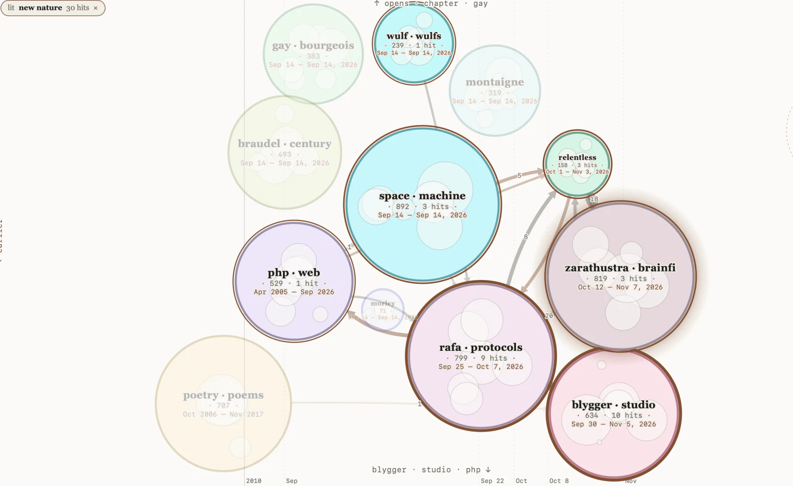
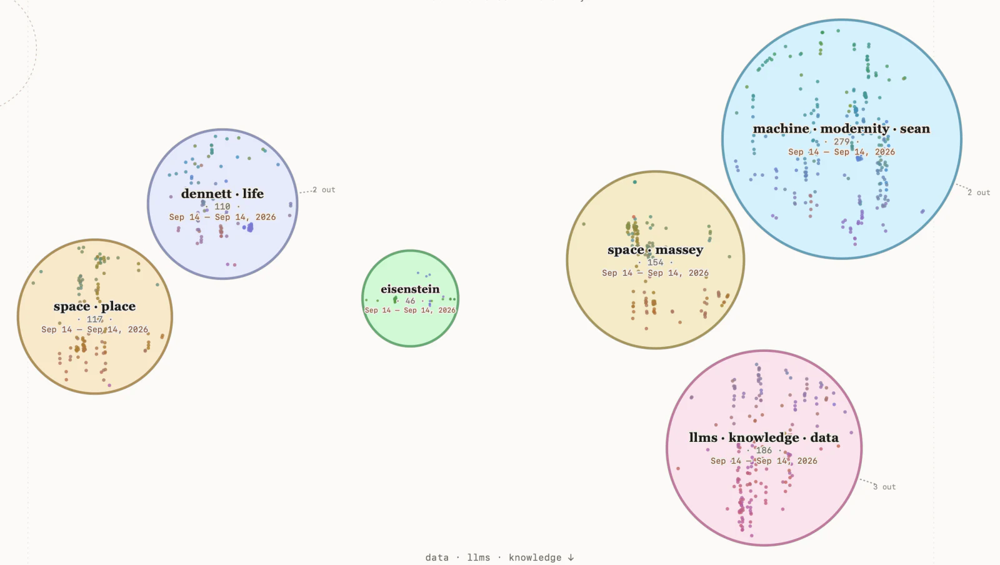
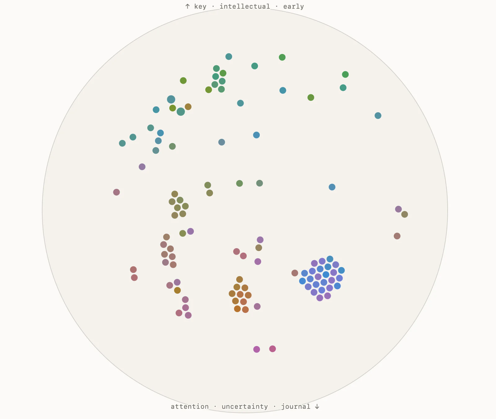

# blyg-atlas

A map of the [blygger](https://blygger.org/spec/0.3/) network that you grow from your own subscriptions and keep on your own machine.



 

<sub>The Field. Top: the whole network as regions, with a search lit and the citations between regions drawn as arrows. Below: inside one region, then the items at the bottom level, colored by what they are about.</sub>

<!-- CLIP: a ~20 s screen recording of the Field goes here. -->

It crawls the blygs you follow and the blygs they quote, keeps every item and every citation between items in one local SQLite file, and lays the result out as the **Field**: each item placed by what it is about and when it was written, gathered into named regions you can open, with the citations drawn as arrows between them. Under the map there is a search that follows citations, a view of what moved since you last looked, and standing queries.

I find it useful to browse semantic space visually; the interface is designed to help pore over large quantities of text with assorted temporal/semantic interconnections in an aesthetically pleasing way.

## Why it runs on your machine

Blygger leaves one thing off the wire on purpose: you cannot ask a blyg who has responded to it. The spec's reasoning (§16.6d) is that a machine-readable list of responders is a follower list by another name. The same section says what a reader may do instead: walk outward from their own subscriptions through transclusions, stubs, forks and blogrolls, and order what they find locally, provided nothing derived from the walk is published.

blyg-atlas is that walk, kept in a database. So this repository holds code and no network data. Every install crawls from its owner's seeds and sees the network from there. What you read, what you searched for and what you kept stay in `atlas.db`, which is gitignored, and the dashboard listens on loopback only. That is also why there is no hosted version.

## Quickstart

Needs Node 20 or later.

```bash
git clone https://github.com/Allethrin/blyg-atlas && cd blyg-atlas
npm install
cp seeds.example.json seeds.json     # the blygs you follow; edit it, one is enough
npx blyg-atlas crawl                 # walk the network from your seeds and embed what it finds
npx blyg-atlas serve                 # the Field at http://127.0.0.1:5053
```

If an AI agent is doing the setup for you, point it at [`AGENTS.md`](AGENTS.md): the same steps, written for it.

What the first run costs, measured in November 2026 on an Apple M5 laptop from the two example seeds (about 30 blygs, 6,000 items):

| step | time | notes |
|---|---|---|
| `npm install` | seconds | about 500 MB of dependencies |
| crawl: fetching | about 7 min | prints progress; later runs fetch only what changed |
| crawl: embedding | about 7 min with Ollama, about 20 without | see below |
| first open of the Field | about 20 s | the layout is computed once per crawl and cached |
| first search | about 40 s | a one-time 280 MB reranker download, then about 3 s |

The database for that network is about 125 MB.

**Embeddings.** Items are embedded with `nomic-embed-text`. If [Ollama](https://ollama.com) is running with that model pulled (`ollama pull nomic-embed-text`), the atlas uses it. If not, it runs the same model inside the Node process: no setup, a one-time 550 MB download, about a third the speed. The two produce the same vectors, so you can start without Ollama and add it later without redoing anything. A running dashboard that loses Ollama carries on with the in-process model and goes back to Ollama within a few minutes of it answering again.

**Seeds.** A seed can be a blyg's address, its feed, or a page that declares one. The crawl follows citations and blogrolls outward from the seeds for `--hops` steps (default 2). Ordinary blogs it meets on the way are noted and not read.

`npx blyg-atlas help` lists the commands.

## Reading the Field

The Field opens on the whole network.

- **Left to right is time**, oldest on the left. Items are spaced by their order, not by the calendar, so a blog archive reaching back twenty years does not squeeze the last two months into a sliver. The date ticks show how uneven the calendar is.
- **Up and down is meaning.** Items about similar things sit at similar heights. Two more directions of meaning lie behind the screen. What you see is a slice through them.
- **Circles are regions**: groups of items about the same thing, named by the words that set them apart from everything else, each with the span of dates it covers. A circle's area is the number of its items inside the slice. Click a circle to open it into its scenes (one theme over one stretch of time), and a scene to see its items as dots. Esc, the breadcrumb or a click on the background goes back out.
- **Arrows are citations**, drawn from the item that was quoted to the item that quotes it, so they mostly point forward in time. Between circles, an arrow's width is how many citations it stands for.
- **A ring around a dot** marks an item its author came back to and revised. Hover it, or open it, and its history unfolds along the time axis: a line from where it was first written to a tick at each later version. The drawer lists the versions with their notes. A blyg publishes only the latest text of an item, so there is nothing to diff. Revisions a blyg made to many of its items within minutes of each other (a re-import, a byline changed everywhere) are counted but not drawn.
- **The slice.** Two depth sliders move it through the two hidden directions, the tilt turns it toward one of them, and thickness runs from a thin cut to everything at once. Circles swell and shrink as the slice enters and leaves them. The labels on the rim of the view say what each edge is about at the current angle.
- **Reading.** Among the dots, a loupe follows the pointer and opens the nearest items into small circles of text. Dots that would land on top of each other are nudged apart until they touch, so a pile reads as a small cluster and each one can be clicked. Click an item to read it in a drawer beside the map, and pop it out into a card you can drag aside.
- **Color** is meaning by default: nearby colors are nearby subjects, and a grey circle is a mixed one. It can also show which blyg an item is from, how old it is, or whether you have read it.
- **Pulse** puts a glow where something happened in the last 1, 3, 7 or 14 days, or since you last pressed *mark all seen* on the pulse tab (*unseen*). The side panel lists those threads; click one to go there.
- **Searching from the Field.** The search bar at the top runs the atlas search and lights up where the hits are; *as a list* beside the map shows the same search ranked. Everywhere else the bar gives the list.

The view is written into the address bar, so a view is a link. Keys: `/` search, `f` full screen (`h` shows the controls there), `p` rim labels, `m` loupe, `c` color, `z` fill, `e` ease.

There are more ways to look at the same data than this one: circles arranged by their citations instead of by a slice, a flat plane, a space with four directions of meaning and no time, and one whose axes are fitted to the citations. They are built but not offered by default. `field` in `atlas.config.json` turns them on (see `atlas.config.example.json`).

## How it works

**1. The crawl builds a typed graph.** A blyg publishes a manifest, an index, and one JSON document per item. The crawler reads those and records each way one item points at another:

| citation | what it is | weight in search |
|---|---|---|
| transclusion | a quoted passage, pinned to a version | 1.0 |
| stub | a response to an item | 0.9 |
| fork | a copy that became its own item | 0.8 |
| link | a bare reference | 0.5 |

Blogrolls connect blygs to blygs. Every blyg already in the atlas is re-checked on each run with a conditional request, and only items whose version moved are fetched again.

**2. Each item gets a vector.** `nomic-embed-text` turns an item's title and text (the first 6,000 characters) into 768 numbers. Items about similar things get similar vectors.

**3. The layout is three directions of meaning plus time.** [UMAP](https://pair-code.github.io/understanding-umap/) reduces the 768 numbers to three while trying to keep neighbors together. The fourth coordinate is the item's rank by creation date, stretched to be as wide as the widest of the three. So time is a place on the map, not a filter over it.

UMAP's axes mean nothing in themselves: "up" is not a subject. That is why the view is something you find by tilting, and why the rim labels are computed afterward from whatever items ended up at each edge.

**4. Regions are clusters in that layout.** k-means, at two levels: up to twelve themes clustered on the meaning directions alone, and inside each theme up to six scenes clustered on meaning and time together. Clustering in the layout, not in the original 768 dimensions, makes each region one contiguous place on the map.

A region is named by the terms that carry the largest share of the difference between its word frequencies and the background's (the whole field for a theme, the theme for a scene). Lines that a single blyg repeats across many of its items are dropped first, so a byline or a boilerplate sentence does not outrank the subject. The score for a term is p_region · log(p_region / p_background), which passes over words that are common everywhere and picks out the ones that are common here.

**5. The screen is a slice.** The view is a plane through the four-dimensional layout, with time fixed along the horizontal. Each item has a distance d from that plane in the two directions the screen does not show, and a weight exp(−(d/σ)²), where σ is the thickness. A circle's area is the sum of its items' weights. An arrow between two regions has width Σ wᵢ·wⱼ over the citations between them, so both thin out as the slice moves away. At infinite thickness every weight is 1 and the view is a plain projection.

This is a slice tour over a UMAP layout: the [grand tour](https://distill.pub/2020/grand-tour/) idea of looking at high-dimensional data by moving a low-dimensional window through it, with regions in place of points until you reach the bottom.

**6. Color is a second map.** A separate two-dimensional UMAP layout is read in polar form: an item's angle around the middle sets its hue and its distance from the middle sets how saturated it is (in OKLab, at fixed lightness). A circle takes the average color of its items, which is why a mixed region comes out grey. Because it is a different flattening from the positions, color sometimes separates what position stacks together.

**7. Search follows citations.** A query is embedded and the twelve nearest items become seeds. Activation spreads from them along citations in both directions, multiplied by the citation's weight and by 0.6 per step, for two steps. A cross-encoder (`jina-reranker-v2-base-multilingual`, run locally) then reorders the pool against the query text. Every hit carries the path that reached it, such as "seed, cosine 0.71" or "quoted by" a seed, so you can see why it surfaced. The walk is how a reader finds the rest of a thread the wire will not list.

More on the pieces: [Understanding UMAP](https://pair-code.github.io/understanding-umap/) (interactive, no math needed), [How UMAP works](https://umap-learn.readthedocs.io/en/latest/how_umap_works.html), the [UMAP paper](https://arxiv.org/abs/1802.03426) (McInnes, Healy and Melville, 2018), and [Visualizing neural networks with the grand tour](https://distill.pub/2020/grand-tour/).

## Under the map

The dashboard's other tabs, and the same things from the shell:

- **Search**: the search described above. `blyg-atlas search "standing queries" --top-k 8`
- **Pulse**: what moved in a window, grouped into threads and weighted toward the blygs you actually read. This is a diff over timestamps, not a search. `blyg-atlas pulse --days 3`
- **Queries**: standing queries. You declare a query in your own words; each run ranks what changed since you last looked against it; items you keep under a query widen what later runs can reach without changing how they are ranked. `blyg-atlas query add "…"`, `query run --all`
- **Recent**, **map**: the newest items; the blygs the atlas holds, what it has seen but not crawled, and quotes whose source has changed since it was quoted.
- **History**: what you opened, when, and for how long. It never leaves the database. Pulse uses it to learn which blygs are your neighborhood.
- `blyg-atlas thread <id|url>` shows what an item responds to and what responds to it, as far as your crawl reaches. `item`, `lineage`, `stale`, `frontier` and a read-only `sql` are there too.

## Keeping it current

Run `blyg-atlas crawl` whenever you like, or on a schedule. `examples/` has a cron line and a launchd plist that crawl each morning and then run the standing queries. They use `crawl --wait 3600`, which keeps retrying while no seed answers; without it a job that fires as a laptop wakes, before its network is up, fails at once.

## From an AI assistant

The same tools are an [MCP](https://modelcontextprotocol.io) server on stdio:

```bash
claude mcp add blyg --scope user -- npx tsx /PATH/TO/blyg-atlas/src/mcp.ts
```

Fifteen tools: `blyg_crawl`, `blyg_search`, `blyg_item`, `blyg_thread`, `blyg_lineage`, `blyg_stale`, `blyg_frontier`, `blyg_map`, `blyg_recent`, `blyg_pulse`, `blyg_reads`, `blyg_queries`, `blyg_query_run`, `blyg_query_keep`, `blyg_sql`. Their descriptions are in `src/tools.ts`.

## Configuration

Nothing needs configuring for a first run. `atlas.config.json` (copy `atlas.config.example.json`; gitignored) and environment variables cover the rest:

- `contact`: goes in the crawler's User-Agent, beside this repository's address, so a site you crawl can reach you. Set it to something of yours; a crawl that finds new blygs reminds you while it is unset.
- `own_origin`: your own blyg, if you publish one, so your items stay out of your pulse and queries.
- `embedder`: `auto` (default), `ollama` or `local`.
- `field`: which views the Field offers.
- `port`, `db`, `seeds`: where things live. `src/config.ts` has the full list with the environment variable for each.
- `BLYG_RERANK_MODEL` (environment): a different reranker. A small local one such as `Xenova/ms-marco-MiniLM-L-6-v2` is faster and scores on a different scale; `jina-reranker-v2-base-multilingual` with `JINA_API_KEY` set uses Jina's hosted copy of the default.

## What is in the repo

```
src/            crawl and graph (core), search, embed, rerank, pulse, query, the Field (field, field-core), serve, mcp, cli, config
public/         the dashboard: one HTML file, field.js, field.css; no build step
docs/img/       the screenshots above
examples/       scheduling and MCP registration
```

## Known limits

- **Region names are word statistics.** Lines that one blyg repeats across many of its items (a byline, a disclosure sentence, a section heading) are left out before naming, but a recurring word that varies in form, such as a numbered heading, can still end up in a name.
- **The map moves between crawls.** The layout is recomputed when the set of items changes, so regions shift and may be renamed. A saved view keeps its angle and thickness, not its contents.
- **The Field needs the internet on each page load**: it loads d3 from a CDN.
- **Tested on macOS with Chrome.** Linux should work and has not been tried. Trackpad pinch in Safari is written but untested.
- **One point per item.** A very long thread is embedded as a whole, from its first 6,000 characters.
- **The same blyg at two addresses counts twice**, because the spec makes the address the identity.
- **Dropping a seed does not drop what was crawled from it.** Delete `atlas.db` to start over; it rebuilds from the network, though your history, queries and keeps go with it.
- **"Who responded" covers only what you have crawled.**

What is planned or being considered is in [`ROADMAP.md`](ROADMAP.md).

## Credits and license

The Blygger protocol was started by Venkatesh Rao; this is an independent reader-side tool for it. Built by Ben Mayhew, working with an AI assistant.

MIT. See `LICENSE`.